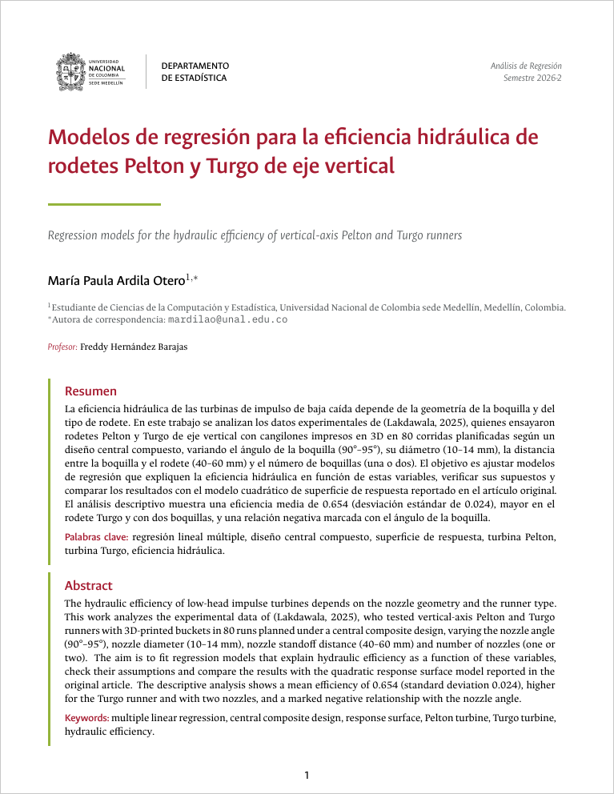

# Artículo de regresión: eficiencia hidráulica de turbinas de impulso

Proyecto del curso **Análisis de Regresión** (2026-2), Universidad Nacional de Colombia, sede Medellín.
Docente: Freddy Hernández Barajas.
Autora: María Paula Ardila Otero.

## Objetivo

Aplicar modelos de regresión a los datos experimentales de un artículo científico para explicar y predecir
la eficiencia hidráulica de turbinas de impulso a pequeña escala (pico hidro) en función de variables de
diseño de la boquilla y del rodete.

## Artículo

<p align="center">
  <a href="Articulo_LaTeX/Articulo_regresion.pdf">
    
  </a>
</p>

<p align="center">
  <a href="Articulo_LaTeX/Articulo_regresion.pdf"><b>Ver el artículo en PDF</b></a>
</p>

Versión actual: introducción, datos y análisis descriptivo. El ajuste y la validación del modelo de
regresión se agregarán en las siguientes entregas.

## Artículo de referencia

Lakdawala, H. N., Patel, V. K., Bakhru, G. P. y Modi, D. N. (2025). Performance optimization of low-head
vertical axis impulse turbine runners for nozzle angle, nozzle diameter, and nozzle standoff distance using
response surface methodology. *Journal of Thermal Engineering*, 11(5), 1392–1419.
https://doi.org/10.14744/thermal.0000983

## Datos

El archivo `datos.xlsx` contiene las 80 corridas experimentales de la Tabla 6 del artículo, obtenidas con un
diseño central compuesto (CCD) con cabeza hidráulica constante de 10 m.

| Variable     | Descripción                                          | Tipo          | Unidad / niveles          |
|--------------|------------------------------------------------------|---------------|---------------------------|
| `corrida`    | Número de la corrida experimental                    | Identificador | 1 a 80                    |
| `angulo`     | Ángulo de la boquilla (incidencia del chorro)        | Numérica      | grados (90, 92.5, 95)     |
| `diametro`   | Diámetro de la boquilla (chorro)                     | Numérica      | mm (10, 12, 14)           |
| `distancia`  | Distancia entre la punta de la boquilla y el rodete  | Numérica      | mm (40, 50, 60)           |
| `rodete`     | Tipo de rodete                                       | Categórica    | PTR = Pelton, TTR = Turgo |
| `boquillas`  | Número de boquillas                                  | Categórica    | 1 o 2                     |
| `eficiencia` | Eficiencia hidráulica (**variable respuesta**)       | Numérica      | proporción (0 a 1)        |

**Nota sobre los datos:** las corridas 12 y 13 tienen los mismos valores en las cinco variables explicativas
(90°, 14 mm, 40 mm, Pelton, 1 boquilla) pero eficiencias muy distintas (0.6285 y 0.6765), y en el diseño falta
la combinación 95°, 14 mm, 40 mm, Pelton, 1 boquilla. Posiblemente se trata de un error de digitación en la
Tabla 6 del artículo original. Los datos se dejaron tal como fueron publicados.

## Análisis descriptivo en R

El script `anal_descrip.R` descarga `datos.xlsx` directamente desde este repositorio y hace el análisis
descriptivo completo: resumen de la eficiencia, comparación por niveles de cada variable, intervalos de
confianza para las medias, gráficos de perfiles, gráfico condicional, correlaciones y matriz de dispersión.

Para correrlo basta con abrirlo en RStudio y ejecutarlo completo (`Ctrl + Shift + Enter`). Necesita conexión a
internet; los paquetes que falten (`readxl`, `ggplot2` y `GGally`) se instalan automáticamente.

## Estructura del repositorio

```
Articulo_regresion/
├── README.md
├── datos.xlsx                    # datos de la Tabla 6 del artículo
├── anal_descrip.R                # análisis descriptivo
└── Articulo_LaTeX/
    ├── Articulo_regresion.pdf    # artículo compilado
    ├── vista_previa.png          # imagen de la primera página (para este README)
    ├── main.tex                  # documento principal
    ├── Config/                   # datos del trabajo, preámbulo, colores y fuentes
    ├── Secciones/                # una sección del artículo por archivo
    ├── Figs/                     # figuras del artículo
    └── Imágenes/                 # logos
```

El artículo se compila con **XeLaTeX** (las fuentes se cargan con `fontspec`), tomando como raíz la carpeta
del repositorio.

## Fuente y licencia de los datos

Los datos y las figuras del montaje experimental provienen del artículo citado arriba, publicado en acceso
abierto bajo licencia CC BY-NC 4.0. Se usan aquí únicamente con fines académicos.
