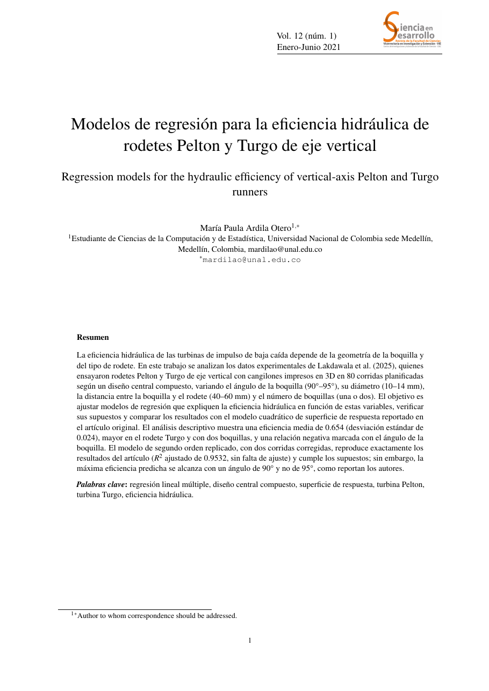

# Artículo de regresión: eficiencia hidráulica de turbinas de impulso

Proyecto del curso **Análisis de Regresión** (2026-2), Universidad Nacional de Colombia, sede Medellín.
Docente: Freddy Hernández Barajas.
Autora: María Paula Ardila Otero.

## Objetivo

Aplicar modelos de regresión a los datos experimentales de un artículo científico para explicar y predecir
la eficiencia hidráulica de turbinas de impulso a pequeña escala (pico hidro) en función de variables de
diseño de la boquilla y del rodete.

## Artículo

<p align="center">
  <a href="Articulo_Revista/articulo.pdf">
    
  </a>
</p>

<p align="center">
  <a href="Articulo_Revista/articulo.pdf"><b>Ver el artículo en PDF</b></a>
</p>

Versión actual: introducción, datos, análisis descriptivo y réplica del modelo de regresión de segundo
orden reportado en el artículo original (ANOVA, medidas de ajuste, ecuaciones, diagnósticos y superficies
de respuesta).

## Artículo de referencia

Lakdawala, H. N., Patel, V. K., Bakhru, G. P. y Modi, D. N. (2025). Performance optimization of low-head
vertical axis impulse turbine runners for nozzle angle, nozzle diameter, and nozzle standoff distance using
response surface methodology. *Journal of Thermal Engineering*, 11(5), 1392–1419.
https://doi.org/10.14744/thermal.0000983

## Datos

El archivo `datos.xlsx` contiene las 80 corridas experimentales de la Tabla 6 del artículo, obtenidas con un
diseño central compuesto (CCD) con cabeza hidráulica constante de 10 m.

| Variable     | Descripción                                          | Tipo          | Unidad / niveles          |
|--------------|------------------------------------------------------|---------------|---------------------------|
| `corrida`    | Número de la corrida experimental                    | Identificador | 1 a 80                    |
| `angulo`     | Ángulo de la boquilla (incidencia del chorro)        | Numérica      | grados (90, 92.5, 95)     |
| `diametro`   | Diámetro de la boquilla (chorro)                     | Numérica      | mm (10, 12, 14)           |
| `distancia`  | Distancia entre la punta de la boquilla y el rodete  | Numérica      | mm (40, 50, 60)           |
| `rodete`     | Tipo de rodete                                       | Categórica    | PTR = Pelton, TTR = Turgo |
| `boquillas`  | Número de boquillas                                  | Categórica    | 1 o 2                     |
| `eficiencia` | Eficiencia hidráulica (**variable respuesta**)       | Numérica      | proporción (0 a 1)        |

**Nota sobre los datos:** `datos.xlsx` tiene los datos tal como fueron publicados. En dos corridas los niveles
de la Tabla 6 no coinciden con los valores predichos que reportan los mismos autores: en la corrida 12 el ángulo
corresponde a 95° (no a 90°) y en la corrida 15 la distancia corresponde a 60 mm (no a 40 mm). Los dos scripts
corrigen esos niveles al leer los datos; con la corrección el diseño queda completo y el modelo reproduce
exactamente los resultados del artículo.

## Análisis descriptivo en R

El script `anal_descrip.R` descarga `datos.xlsx` directamente desde este repositorio y hace el análisis
descriptivo completo: resumen de la eficiencia, comparación por niveles de cada variable, intervalos de
confianza para las medias, gráficos de perfiles, gráfico condicional, correlaciones y matriz de dispersión.

Para correrlo basta con abrirlo en RStudio y ejecutarlo completo (`Ctrl + Shift + Enter`). Necesita conexión a
internet; los paquetes que falten (`readxl`, `ggplot2` y `GGally`) se instalan automáticamente.

## Modelo de regresión en R

El script `mod_lin.R` replica el modelo de superficie de respuesta de segundo orden del artículo (19
coeficientes, variables codificadas en −1, 0 y 1): la tabla ANOVA con sumas de cuadrados tipo III (Tabla 7),
las medidas de ajuste (Apéndices A2 y A3), las ecuaciones (6) a (9), los gráficos de diagnóstico (Figura 9),
las superficies de respuesta y contornos (Figura 10) y la revisión del punto óptimo (Tabla 8). Además de los
paquetes anteriores usa `car`.

Los dos scripts guardan sus figuras en `Articulo_Revista/Figs`.

## Estructura del repositorio

```
Articulo_regresion/
├── README.md
├── datos.xlsx                    # datos de la Tabla 6 del artículo
├── anal_descrip.R                # análisis descriptivo
├── mod_lin.R                     # réplica del modelo de regresión
└── Articulo_Revista/
    ├── articulo.pdf              # artículo compilado
    ├── vista_previa.png          # imagen de la primera página (para este README)
    ├── articulo.tex              # documento principal (plantilla de la revista)
    ├── Secciones/                # una sección del artículo por archivo
    ├── Figs/                     # figuras del artículo
    ├── mis_referencias.bib       # referencias
    └── templateRevistaUPTCCiencias.cls
```

El artículo usa la plantilla de la Revista Ciencia en Desarrollo y se compila con **pdfLaTeX** (con
`-shell-escape`, porque la plantilla carga `minted`), con `Articulo_Revista/articulo.tex` como archivo
principal y tomando como raíz la carpeta del repositorio: todas las rutas del documento empiezan por
`Articulo_Revista/`.

## Fuente y licencia de los datos

Los datos y las figuras del montaje experimental provienen del artículo citado arriba, publicado en acceso
abierto bajo licencia CC BY-NC 4.0. Se usan aquí únicamente con fines académicos.
